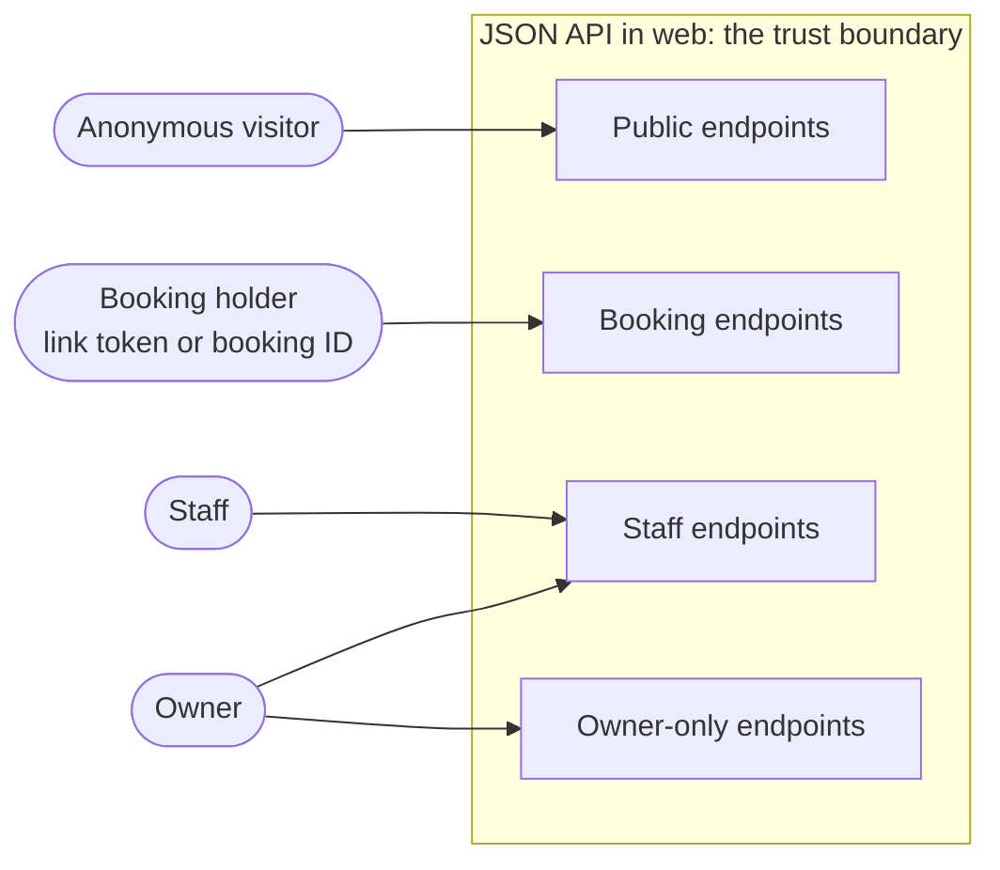

# Access and Trust Boundaries

## Scope

Who may do what, how each caller proves who they are, and where that is enforced. Covers the four access levels, staff roles, access to a booking without an account, phone verification, and the audit trail. The entities involved are in `data-model`; the flows that cross these boundaries are in `flows`. This doc defines no components.

## Context

There is one trust boundary, the JSON API in `web`, with four levels of access behind it. Pages hold no privileges of their own: a dashboard page that renders is not proof of access, because the data it shows comes from API calls that are checked individually.

## Access levels

| Level | Proves itself with | May |
|---|---|---|
| Anonymous | Nothing | Read content, prices, occasions and availability; request and check a verification code; create a hold (with a verified-phone token); look up a booking by ID |
| Booking holder | The booking's link token, or its booking ID | Read that booking's page; upload proof for it |
| Staff | Better Auth session, role `staff` | Everything in the review queue and bookings list: confirm, reject, mark proof received, enter bookings, cancel, mark remainder paid; view screenshots |
| Owner | Better Auth session, role `owner` | Everything staff can, plus prices, occasions, deposit, payment details, schedule, site content, media and staff accounts |

## Staff authentication

Better Auth with password login; users and sessions are stored in `postgres` (ADR-004). Sessions are HTTP-only, secure, same-site cookies. Roles are a field on the staff user. Only the owner creates, disables or resets staff accounts; there is no self-registration and no public sign-up route. A disabled account's sessions stop working immediately.

Every staff endpoint passes through one authorization guard that checks session, active flag and role. Owner-only endpoints declare it in the route definition, so a missing check is visible in code review and coverable by one table-driven integration test.

## Access to a booking without an account

Customers never log in. A booking is reachable two ways:

- **Link token.** A long random token in the booking page URL, sent by WhatsApp or SMS. Holding the link is holding the booking.
- **Booking ID.** A short random code (not sequential, not derived from the date or phone) that the customer can type on the site. Lookup is rate-limited per IP and returns the same "not found" for wrong and nonexistent IDs.

Lookup by phone number does not exist: it would let anyone who knows a family's number see their occasion and date.

What a holder can see is limited to that booking: occasion, slot, status, deposit, transfer details and countdown. What they can do is upload proof while the booking is `held`. They cannot cancel or change it; those happen offline through the owner.

## Phone verification

A hold requires a phone that received a code in the last few minutes. The code is stored hashed, expires quickly, allows a small number of attempts, and requests are rate-limited per phone and per IP. A successful check returns a short-lived verified-phone token bound to that phone; the create-hold endpoint requires it and rejects a token for a different phone. Verification proves control of the phone once; it creates no session and no account.

If the code cannot be delivered on either channel, no hold is created (ADR-016).

## Screenshots

Payment screenshots are served only through a staff endpoint behind the guard. They are never given a public URL and never attached to an outgoing message (ADR-013). Uploads are checked for type and size before being written.

## Webhooks

The Twilio status webhook is the one endpoint called by a machine. It is authenticated by Twilio's request signature and accepts only delivery-status updates for messages Wesal sent.

## Audit

Every staff action that changes a booking or a setting writes an append-only row: who, what, which booking, when, and the before and after where relevant. Confirm, reject, mark proof received, manual entry, cancel, remainder paid, price or schedule change, and staff account changes are all audited. Customer actions are recorded on the booking itself (created, proof uploaded), not in the staff audit log.

## Failure behavior

| Dependency | If unavailable | Degrades or stops |
|---|---|---|
| `postgres` | No session can be checked | Stops; staff endpoints refuse rather than allow |
| Twilio | No codes | Degrades; no new online holds, staff login unaffected |

## Constraints

- Authorization is enforced only in the API layer; no page or job bypasses it.
- A missing or invalid session always denies; there is no fail-open path.
- Rate limits are per process, which is sufficient while `web` is one machine.

## Change cost

**Cheap:** adding a role or moving an action between owner and staff; adding audited actions.

**Expensive:** introducing customer accounts (out of scope today; it would change how every booking is reached); moving rate limits to shared storage if `web` ever runs as more than one machine.

## Decisions

- ADR-004 — Better Auth for staff login
- ADR-012 — JSON API from day one, used by the web UI
- ADR-013 — Staff alert carries a link, not the image
- ADR-016 — A failed verification stops the booking
