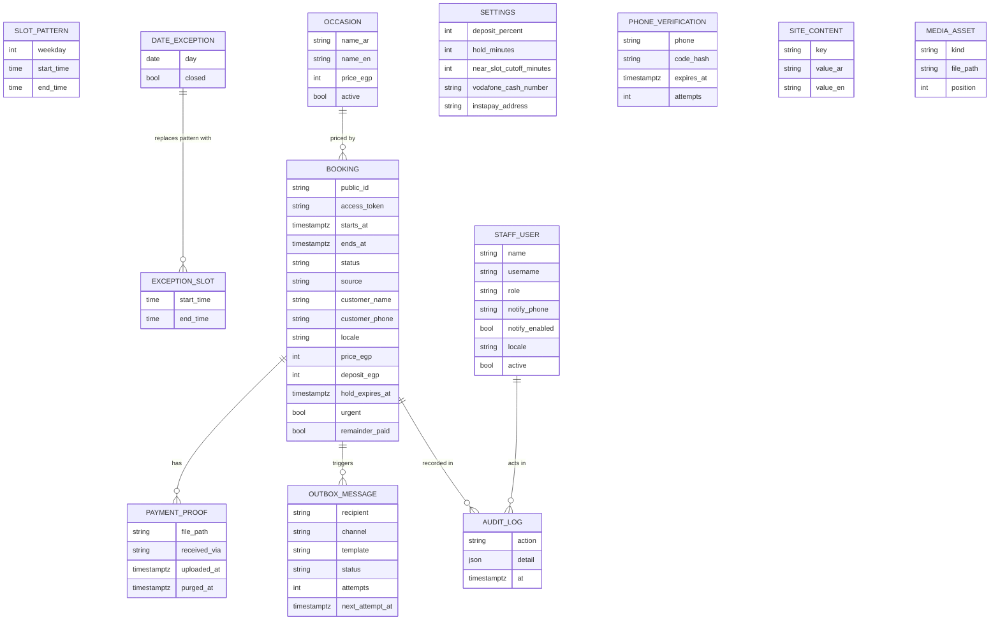
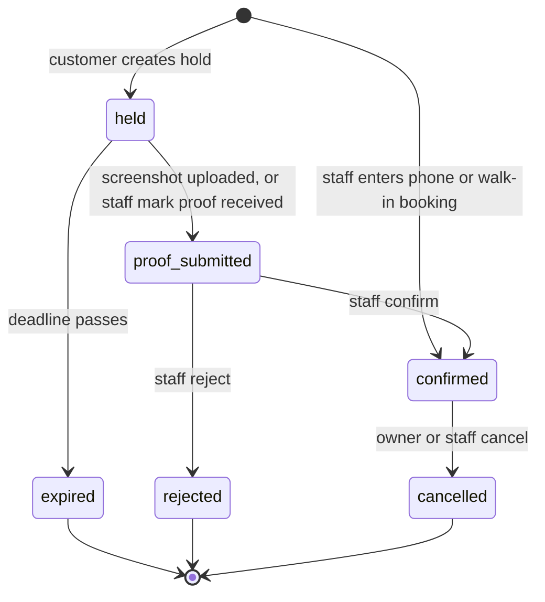

# Data Model

## Scope

The entities Wesal persists, who owns them, how they relate, and the lifecycle of a booking. Column-level detail belongs to the migrations; this doc fixes the entities, the invariants the database enforces, and the booking states. Who may read or change each entity is in `auth`. This doc defines no components of its own; it describes data held by `postgres` and `upload-volume`, defined in `overview`.

## Context

All data is written by the service layer in `web` and stored in `postgres`. Files (venue media and payment screenshots) are stored on `upload-volume`, each with a row in `postgres` that points at it. Nothing outside `web` reads or writes this data.

## Entities

The diagram shows three groups. **Schedule**: the weekly pattern, and date exceptions that either close a date or replace its slots. **Bookings**: a booking with its proofs, the messages it triggers and its audit trail. **Venue**: occasions, the single settings row, site content, media and staff.

Better Auth's session, account and verification tables belong to `web` (ADR-004) and are omitted from the domain ER; `booking.source` records whether staff entered the booking, and the audit row names the staff user who did.

Two points are easy to miss. First, slots are not stored rows: a date's slots are computed from the pattern and exceptions. A booking stores its own start and end timestamps, so later schedule edits never alter an existing booking. Second, a booking snapshots the occasion's price and the deposit at creation, so later price changes never alter what a customer was quoted.

## Data ownership

| Entity | Owner | Store | Consistency |
|---|---|---|---|
| Slot pattern, date exception, exception slot | `web` service layer | `postgres` | Strong |
| Occasion, settings | `web` | `postgres` | Strong |
| Booking | `web` | `postgres` | Strong; overlap of active bookings rejected by the database |
| Payment proof | `web` | Row in `postgres`, file on `upload-volume` | Strong for the row; the file is removed after one day |
| Phone verification | `web` | `postgres` | Strong |
| Outbox message | `web` | `postgres` | Strong; delivery is at-least-once |
| Staff user, session | `web` (Better Auth) | `postgres` | Strong |
| Audit log | `web` | `postgres` | Strong; append-only |
| Site content, media asset | `web` | Row in `postgres`, file on `upload-volume` | Strong |

## Invariants enforced by the database

- **No overlapping active bookings.** An exclusion constraint on the booking's time range, restricted to rows whose status is `held`, `proof_submitted` or `confirmed`. Because the constraint is on time ranges, it also protects against overlap when a date exception changes slot times. It needs the `btree_gist` extension and is written as SQL in a migration.
- **Expiry does not depend on a job.** The constraint cannot read the clock, so hold creation runs in one transaction: first mark any `held` booking on that range whose deadline has passed as `expired`, then insert. A constraint violation is reported as the slot-conflict error. Readers treat a `held` row with a past deadline as free (ADR-010).
- **Unique identifiers.** `public_id` and `access_token` are unique; both are random.
- **Audit rows are never updated or deleted.** A trigger on `audit_log` refuses UPDATE and DELETE.
- **Settings is a single row.**

## Booking lifecycle

A booking is created in one of two ways: a customer's hold, or a staff entry that starts confirmed. `held` is the only state with a clock. Uploading proof (or staff marking proof received over WhatsApp) stops the clock; from then on only a staff decision moves the booking. `expired`, `rejected` and `cancelled` are terminal and free the slot at once; a customer whose booking ends in any of them starts again like anyone else.

Public slot states map from this: free (no active booking), awaiting payment (`held`, deadline in the future), awaiting review (`proof_submitted`), confirmed, and closed (the date is closed by an exception).

## Retention

- Payment screenshots are kept for one day, but a file is never deleted while its booking is still awaiting review. The daily job purges files older than a day whose booking has left `proof_submitted`, and stamps `purged_at`; a proof that has awaited review for days is purged on the first daily run after staff decide. The row stays so the audit trail still shows that a proof existed.
- Booking records and the audit log are kept; nothing else has a stated retention rule.
- Phone verification rows and sent outbox rows may be pruned by the sweep once they are no longer needed.

## Constraints

- All timestamps are stored with time zone; slot times are interpreted in Africa/Cairo.
- Prices and deposits are whole EGP.
- Scale is small; no table is expected to exceed tens of thousands of rows in years of use. No partitioning or archiving is planned.

## Change cost

**Cheap:** adding fields to a booking; adding occasions; adding content keys; adding outbox templates.

**Expensive:** moving from owner-defined slots to free-form start times (the resolver, the calendar and the hold endpoint all assume slots); letting two bookings share a slot (the exclusion constraint is the core invariant); splitting the venue into separately bookable spaces.

## Decisions

- ADR-002 — PostgreSQL, self-run on Fly
- ADR-003 — Drizzle as the data layer
- ADR-005 — Files on a Fly volume; screenshots kept one day
- ADR-010 — Hold expiry by timestamp
