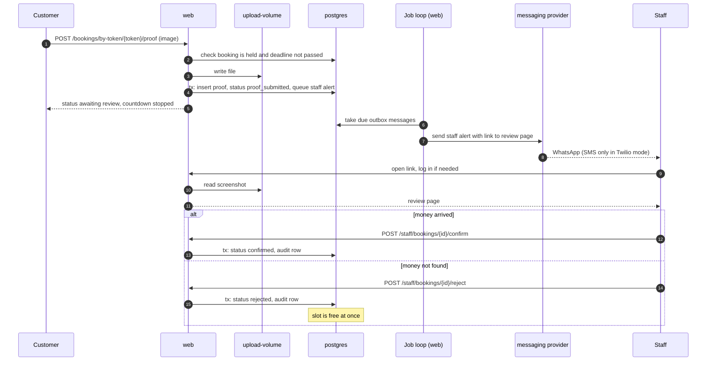
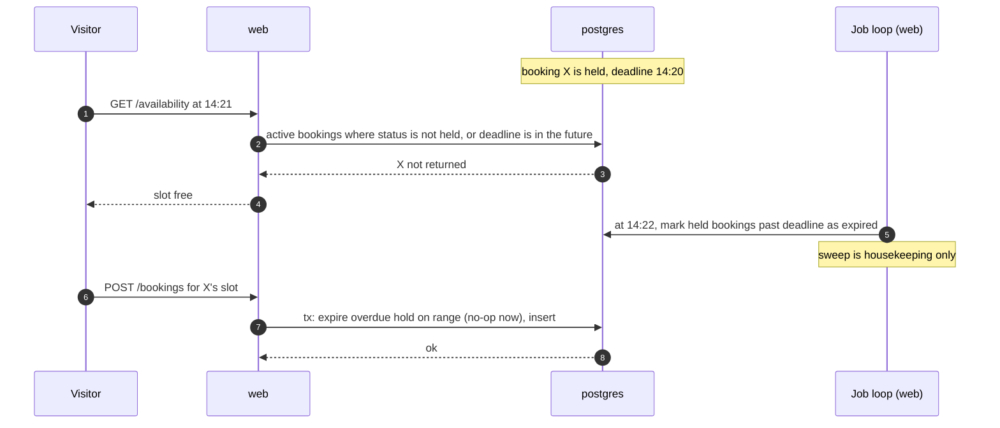
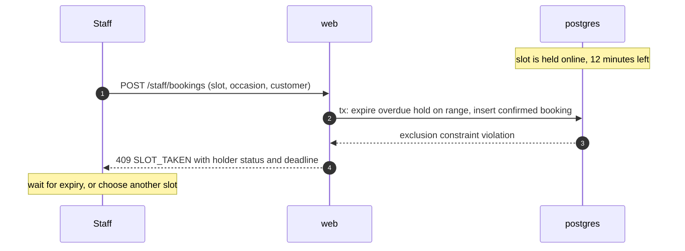
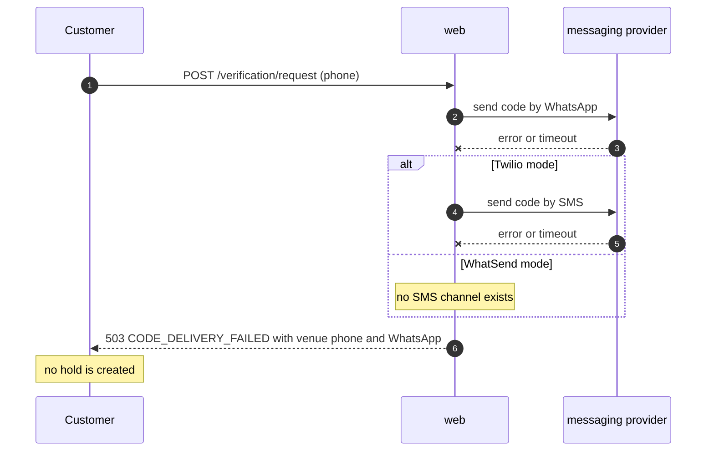

# Critical Flows

## Scope

The five flows that define Wesal, traced end to end through the components in `overview` and the entities in `data-model`. Screen-level behavior is in the feature specs and view docs; this doc fixes the order of operations and where each rule is enforced. It defines no components.

## Context

Every flow starts at a browser (or at the job loop inside `web`), passes through the JSON API into the service layer, and touches `postgres`, `upload-volume` or Twilio from there. In the diagrams, "web" means the API plus service layer unless the job loop is named.

## Flow 1: Creating a hold, with a race

```mermaid
sequenceDiagram
  autonumber
  participant A as Customer A
  participant B as Customer B
  participant W as web
  participant P as postgres
  participant M as messaging provider
  A->>W: POST /verification/request (phone)
  W->>P: store hashed code
  W->>M: send code (inline; Twilio: WhatsApp then SMS; WhatSend: WhatsApp only)
  M-->>A: code
  A->>W: POST /verification/check (phone, code)
  W-->>A: verified-phone token
  par A and B submit the same slot
    A->>W: POST /bookings (slot, occasion, name, token)
    B->>W: POST /bookings (same slot, own token)
  end
  W->>P: tx A: expire overdue hold on range, insert held booking
  P-->>W: ok
  W->>P: tx B: expire overdue hold on range, insert held booking
  P-->>W: exclusion constraint violation
  W->>P: queue booking-link message for A (outbox)
  W-->>A: 201 booking id, link token, deadline, deposit
  W-->>B: 409 SLOT_TAKEN
  Note over B: "This slot is being booked by someone else"
```

The verification code is the only message sent inside a request, because the customer is waiting for it (ADR-011). The channel is the provider's: Twilio tries WhatsApp and then SMS, the WhatSend worker tries WhatsApp only (ADR-031). The hold itself is one transaction, and the database decides the race: whichever insert commits first wins and the other receives a constraint violation, which the API reports as `SLOT_TAKEN`. Customer B went through verification too; a verified phone earns the right to try, not the slot. The deadline is the hold length from settings, shortened if the slot starts soon (see `booking-hold`).

## Flow 2: Proof upload, staff alert, confirm or reject



Uploading stops the clock: from `proof_submitted` on, only a staff decision moves the booking. The alert carries a link, never the image (ADR-013), so the screenshot is only ever served to a logged-in staff session. If the customer sends the screenshot over WhatsApp instead, staff use "mark proof received", which performs step 4 without a file. A rejected booking frees the slot immediately and the customer starts again. The alert goes by WhatsApp only under the WhatSend provider; the SMS fallback and delivery callback shown above exist in Twilio mode (ADR-031).

## Flow 3: Expiry by timestamp, and the sweep



The slot is free at 14:20:00 whether or not the sweep has run, because every read compares the deadline with the clock (ADR-010). The sweep exists so stored status matches reality for the dashboard and reports. If the job loop is down, step 5 never happens and step 7 still succeeds, because hold creation expires the overdue row itself inside its transaction.

## Flow 4: Staff enter a phone booking while an online hold is active



Staff entries go through the same constraint as customer holds; there is no override. The response tells staff who holds the slot and until when, so they can tell a caller "try again in 12 minutes". This is what makes the public calendar the single record of every booking.

## Flow 5: The verification code cannot be delivered



When every channel the configured provider offers fails, nothing is held (ADR-016). Twilio has a second, paid channel; the WhatSend worker does not, so its WhatsApp failure is final (ADR-031). The page shows the venue's phone and WhatsApp so the owner can enter the booking by hand, which then follows flow 4. The calendar can never be filled by unverified numbers, at the price of no online bookings during a messaging outage — and in WhatSend mode that outage is any WhatsApp failure.

## Failure behavior

| Step that fails | Effect |
|---|---|
| Code send (flow 1, step 3) | Flow 5 |
| Outbox send (flow 2, step 7) | The message stays queued and is retried with backoff. In Twilio mode a WhatsApp failure falls back to SMS; in WhatSend mode there is no fallback and the message is marked failed after its attempts. The booking is unaffected and visible in the review queue |
| Worker down or unlinked (WhatSend, flow 1 step 3) | Flow 5 with no SMS attempt; `/health` reports the session state when the worker answers |
| File write (flow 2, step 3) | Upload fails with a retry prompt and the WhatsApp button; the hold clock keeps running |
| Sweep (flow 3, step 5) | No user-visible effect |
| `postgres` during any flow | The request fails; the static contact notice is shown |

## Constraints

- No flow keeps a connection open; the calendar and the booking page poll.
- Every status change and its side effects (audit row, outbox row) commit in one transaction, so a message is never queued for a change that did not happen.
- Outbox delivery is at-least-once; templates are safe to receive twice.

## Change cost

**Cheap:** adding a new message to a flow (queue another outbox row); changing who is alerted.

**Expensive:** adding a staff override for the overlap rule; moving code delivery to the outbox (the booking form would have to poll for delivery).

## Decisions

- ADR-010 — Hold expiry by timestamp
- ADR-011 — Verification codes inline, everything else through an outbox
- ADR-013 — Staff alert carries a link, not the image
- ADR-014 — Calendar freshness by 30-second polling
- ADR-016 — A failed verification stops the booking
- ADR-030 — Twilio over fetch with a bounded retry schedule
- ADR-031 — The WhatSend worker as a fee-free WhatsApp provider for now
