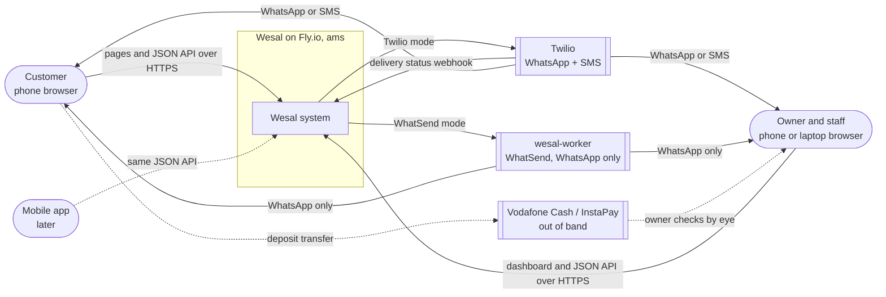
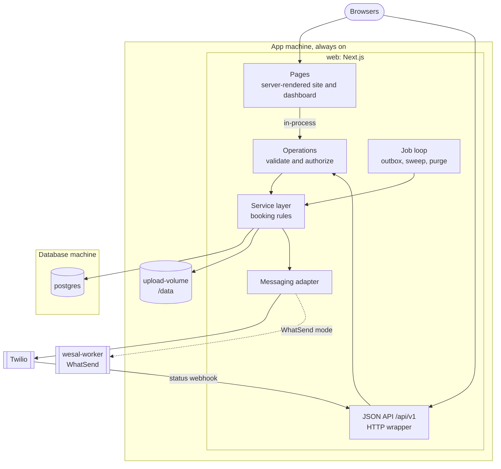
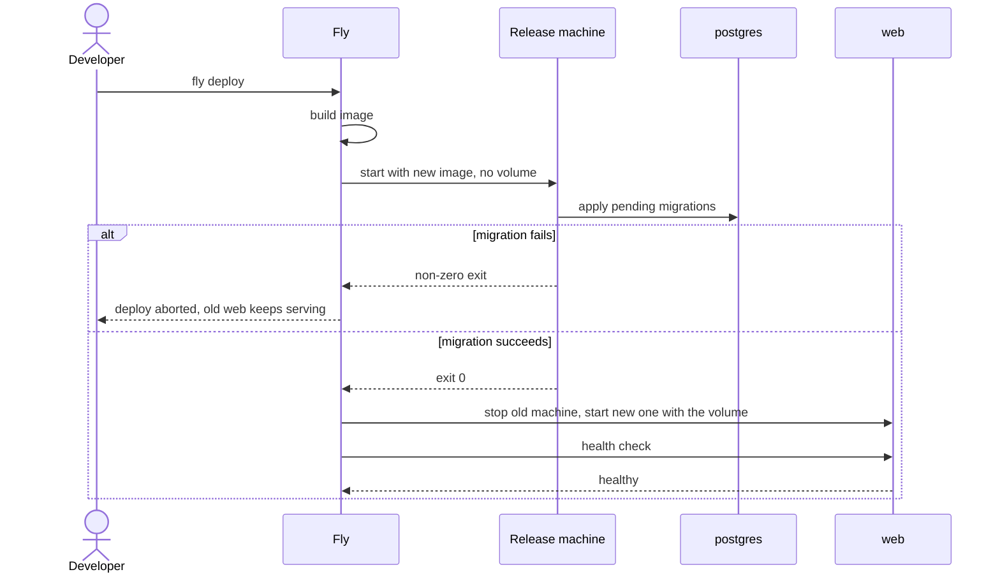

# System Overview

## Scope

The shape of the whole system: what runs, what talks to what, where each concern lives, how it is deployed, how the system fails, and what the shape makes cheap or expensive to change. Entities and their ownership are in `data-model`; the critical flows are traced in `flows`; trust boundaries and roles are in `auth`; test discipline is in `testing`.

## Context

Three kinds of people reach the system, all over HTTPS: customers on phones, the owner and staff in the dashboard, and later the mobile app through the same JSON API. Wesal calls one messaging provider at a time, chosen by `MESSAGING_PROVIDER`: Twilio, which sends WhatsApp with an SMS fallback and reports delivery by callback, or the WhatSend worker, which sends WhatsApp only and reports nothing (ADR-031). The worker is a separate Fly app owned by the sibling WhatSend project, not part of `web`. Twilio is the only provider that calls back. The deposit itself never touches Wesal: the customer transfers it through Vodafone Cash or InstaPay and the owner checks his own phone. That edge is drawn dotted because no data crosses it; the screenshot is the only trace.

## Components

| Component | Responsibility | Owns |
|---|---|---|
| `web` | Serves the public site, the dashboard and the versioned JSON API, applies the booking rules, and runs the in-process job loop | No persistent state of its own |
| `postgres` | Stores every record and rejects any active booking that overlaps another | All relational data |
| `upload-volume` | Holds files on the app machine's Fly volume | Venue photos and videos; payment screenshots for one day |

`wesal-worker` is not a Wesal component. It is the WhatSend project's WhatsApp process, deployed as its own Fly app beside `web` and `postgres` when `MESSAGING_PROVIDER=whatsend` (ADR-031). It carries no Wesal data; it holds the linked WhatsApp session on its own volume and forwards rendered messages. It appears in the contracts and failure tables because `web` depends on it in that mode.

`web` is one Next.js process. The boxes inside it are code boundaries, not separately deployed parts.

Every operation the system offers is one **operation function**: it validates its input, checks who is calling, and then calls the service layer. Each `/api/v1` endpoint is a thin HTTP wrapper around exactly one operation. Server-rendered pages call the same operation functions in-process instead of making an HTTP request to their own server (ADR-020); code running in the browser always goes through HTTP. So there are two ways to reach an operation and one way through it: nothing reaches the service layer from outside without passing an operation's validation and authorization. The job loop is the only caller that enters the service layer directly, because it acts for the system and not for a person.

The service layer is the single place booking rules live and the only code that touches `postgres` or `upload-volume`. The messaging adapter isolates the provider, selected by `MESSAGING_PROVIDER`: Twilio (WhatsApp with SMS fallback and delivery callbacks) or the WhatSend worker (WhatsApp only, no callbacks), with a log-only sender in development and tests (ADR-006, ADR-030, ADR-031). Channel capability belongs to the provider, so a WhatsApp-only provider has no SMS fallback and no spec may promise one while it is selected.

`web` has two jobs (serving requests and running timed work) in one process. That is a deliberate consequence of choosing a single machine (ADR-009); the two are separated in code by the service layer and can be split into a worker later.

## Contracts

| From | To | Mode | Protocol | Carries | Initiator |
|---|---|---|---|---|---|
| Browser (public, staff) | `web` | sync | HTTPS: server-rendered pages and JSON API `/api/v1/*` | Page requests; booking, verification, upload, review and settings operations | Browser |
| Pages (server render) | Operations, inside `web` | sync | In-process function call | The same inputs and results as the matching endpoint, plus the caller's session | Page render |
| `web` | `postgres` | sync | SQL over Fly private network, via Drizzle | All reads and writes; transactions for hold creation and status changes | `web` |
| Release machine (per deploy) | `postgres` | sync | SQL over Fly private network | Pending Drizzle migrations | Fly, on deploy |
| `web` | `upload-volume` | sync | Local filesystem | Write and read media and screenshots; delete on purge | `web` |
| `web` | Twilio | sync for verification codes; async through the outbox for everything else | HTTPS REST | Recipient, channel, rendered template text | `web` |
| `web` | `wesal-worker` (WhatSend) | sync for verification codes; async through the outbox for everything else | HTTPS REST with a bearer secret | Session id, recipient, rendered template text, idempotency key; WhatsApp only | `web` |
| Twilio | `web` | async | HTTPS webhook with signature check | Delivery status per message; Twilio mode only | Twilio |
| Fly | `web` | sync, periodic | HTTP `GET` health endpoint | Web server up, database reachable, age of the job loop's last tick, WhatsApp session state in WhatSend mode | Fly |
| Mobile app (later) | `web` | sync | The same JSON API | The same operations as the web UI | Mobile app |

Only one provider row is live at a time; the other is unused configuration. The worker is reached on Fly's private network at `http://wesal-worker.internal:3001` and never from a browser.

Trust boundaries sit at the operations: anonymous visitor, holder of a booking link or ID, staff, owner. Authorization is enforced inside the operation function, so it applies equally to an HTTP call and to a server render; the HTTP wrapper and the pages carry no authorization logic of their own, and pages never call the service layer or the database directly. Details are in `auth`.

## Data ownership

`web`'s service layer is the sole writer of every entity; `postgres` stores them; files live on `upload-volume` with a row in `postgres` pointing at each. No other component reads or writes data. The schema itself is changed only by migrations run from the release machine. Two reads are allowed to be stale, both by the same 30-second poll: the public calendar and the booking page's status (ADR-014). Every rule that matters is still decided on current data: the server refuses a double hold regardless of what a stale calendar shows, and a held row past its deadline reads as expired whether or not a poll has run (ADR-010). Entity detail is in `data-model`.

## Flows

Five flows define the system and are traced as sequence diagrams in `flows`:

1. Creating a hold, including two people racing for one slot.
2. Proof upload, staff alert, confirm or reject.
3. Expiry by timestamp, and the tidy-up sweep.
4. Staff entering a phone booking while an online hold is active.
5. A verification code that cannot be delivered (the failure flow).

## Deployment and environments

There are two environments: the developer's machine (with docker-compose Postgres, the fake message sender and CI running the same tests) and production on Fly. There is no staging (ADR-023). The first time a deploy, a migration, the WhatsApp link or a Twilio webhook runs on Fly, it runs in production.

A deploy has three steps and the order is what matters. Migrations run first, from a temporary machine built from the new image (ADR-021); it has no volume and exists only for that command. If a migration fails, nothing else happens and the old version keeps serving. Only then is the app machine replaced, which is the brief outage the single-machine shape accepts (ADR-009). For the moment between the two steps the old code runs against the new schema, so a migration must not break the version it replaces: a column or table is added in one deploy and the old one removed in a later deploy.

When the provider is WhatSend, a third Fly app, `wesal-worker`, runs beside `web` and `postgres` (ADR-031). It is built and deployed from the WhatSend project, has no public address, keeps the linked WhatsApp session on its own volume, and is linked to the venue phone once by scanning a QR code. `web` reaches it over the private network with a bearer secret, configured by `WHATSEND_WORKER_URL`, `WHATSEND_WORKER_SECRET` and `WHATSEND_SESSION_ID`. Deploying `web` does not restart the worker, so the WhatsApp link survives app deploys; the worker is upgraded on its own schedule from its own repository.

## Cross-cutting concerns

- **Authentication and authorization.** Better Auth sessions for staff, with owner and staff roles. Customers have no accounts: a booking is reached by its link token or its booking ID. A phone is verified by one-time code before a hold. See `auth`.
- **Configuration and secrets.** Database URL, auth secret, Twilio credentials and — when WhatSend is selected — the worker URL, its bearer secret and the session id are Fly secrets. Venue settings (prices, deposit percentage, payment details, hold length, cutoff) live in the database and are edited in the dashboard.
- **Background work.** One loop inside `web` wakes on a short interval and runs three jobs: send due outbox messages, mark overdue holds expired, and once a day purge old screenshots. The app machine must stay running, so Fly auto-stop is off. Each job run is isolated: an error is caught and logged and the loop carries on to the next job and the next tick, and each run has a time limit so a hung call cannot hold the loop. The loop records the time of every tick. A watchdog timer in the same process exits the process when the last tick is too old, and Fly's restart policy starts it again (ADR-022).
- **Health.** One health endpoint reports whether the web server is up, whether `postgres` answers, the age of the job loop's last tick, and — in WhatSend mode — whether the worker reports a linked WhatsApp session. Fly uses it to decide whether a new deploy is good; the developer uses it to see at a glance whether jobs and messaging are running. The worker check uses a short timeout and is reported in the body without failing the HTTP status, so a dropped WhatsApp link is visible without making Fly restart a healthy app.
- **Observability.** Fly logs only (ADR-017). Every job run, message failure and unhandled error writes one structured log line with a request or job id. A watchdog exit writes a line naming the stalled loop before the process ends. In WhatSend mode the health check logs one warning when the worker's session is not linked, not on every check.
- **Error handling.** Operations return a typed error with a stable code; the HTTP wrapper puts it in the error envelope and pages receive the same code in-process. The UI maps codes to bilingual messages. Slot conflict and code-delivery failure have dedicated messages with a next step.
- **Internationalization.** Arabic by default with RTL, English available. The locale chosen at booking is stored on the booking and used for that customer's messages.
- **Audit.** Every staff action on a booking or on settings writes an append-only audit row.
- **Time.** All business time is Africa/Cairo. Services take the current time from an injected clock so tests can control it.

## Failure behavior

| Dependency | If unavailable | Degrades or stops |
|---|---|---|
| `postgres` | No page data and no bookings | Stops. A static notice shows the venue's phone and WhatsApp |
| Twilio, both channels (Twilio mode) | Codes cannot be sent; outbox messages wait and retry | Degrades. Browsing works, no new online holds, alerts are delayed and eventually marked failed |
| Twilio WhatsApp only (Twilio mode) | Messages fall back to SMS | Degrades |
| WhatSend worker down (WhatSend mode) | Codes cannot be sent and there is no SMS fallback; outbox messages retry and then fail | Degrades. Browsing works, **no new online holds**, booking links and alerts are lost after their attempts |
| WhatSend session unlinked (WhatSend mode) | The worker answers but WhatsApp rejects every send | Degrades. Same effect as the worker being down; `/health` reports the session state, so a re-link is a deliberate fix, not a customer report |
| Worker accepted a message (WhatSend mode) | The worker returns `202` and sends no callback | Degrades silently. Wesal cannot tell whether WhatsApp delivered; a customer who never receives a link can still find the booking by ID |
| `upload-volume` unwritable or full | Media missing; uploads fail | Degrades. The customer can send proof with the WhatsApp button and staff mark it received |
| One job run throws | That run is logged and skipped; the loop continues | Degrades. A message that keeps failing is retried with backoff and then marked failed |
| Job loop stalls | No messages sent, no sweep, no purge until the watchdog fires | Stops briefly. The process exits and restarts; holds stay correct because expiry is by timestamp |
| `web` restart or deploy | Site and job loop pause for a few minutes | Stops briefly. Holds stay correct because expiry is by timestamp |
| Migration fails on deploy | The deploy is aborted before the app machine is touched | Neither. The old version keeps serving on the old schema |
| Database volume lost | Restore from the Fly daily snapshot | Up to a day of bookings is lost (ADR-015) |

## Constraints

- Small scale: a few bookings a week, up to a few hundred visitors a day.
- One developer builds and operates the system.
- Short outages are acceptable.
- A Fly volume attaches to one machine, so `web` runs as exactly one machine while files live on the volume.
- The app machine is small (256 MB class). Nothing may keep a push-style connection (server-sent events or WebSockets) open per visitor, which is why the calendar and the booking page poll. Ordinary requests, including video streamed in ranges from the volume, are within the constraint.
- An audit trail of staff actions is required.
- One messaging provider is active at a time. The WhatSend worker is a third process with its own volume, run from another repository; it cannot be upgraded in lockstep with `web`.

## Change cost

**Cheap to change:** switching between Twilio and the WhatSend worker (environment variables and one WhatsApp link); hold length, deposit percentage and cutoff (settings); adding the mobile client (the JSON API already exists); adding occasions; adding a job to the loop; adding a staging environment later (a second Fly app from the same image and configuration).

**Expensive to change:** running a second app machine or deploying without downtime, which both require moving files off the volume first; splitting the job loop into a worker; changing the booking time model away from owner-defined slots; changing the public JSON API after the mobile app ships; a schema change the running version cannot tolerate, which takes two deploys; replacing the WhatSend worker with an official WhatsApp provider, which needs a new adapter, template approval and a sender registration.

## Decisions

- ADR-001 — Next.js and TypeScript, full-stack
- ADR-002 — PostgreSQL, self-run on Fly
- ADR-005 — Files on a Fly volume; screenshots kept one day
- ADR-006 — Messaging adapter with Twilio first
- ADR-007 — Deploy on Fly.io
- ADR-009 — Single app machine with in-process jobs
- ADR-011 — Verification codes inline, everything else through an outbox
- ADR-012 — JSON API from day one, used by the web UI
- ADR-014 — Calendar freshness by 30-second polling
- ADR-015 — Backups by Fly volume snapshots only
- ADR-017 — Observability by Fly logs only
- ADR-020 — Server-rendered pages call operations in-process
- ADR-021 — Migrations run as the Fly release command
- ADR-022 — Job runs are isolated and a stalled loop restarts the process
- ADR-023 — Production is the only deployed environment
- ADR-030 — Twilio over fetch with a bounded retry schedule
- ADR-031 — The WhatSend worker as a fee-free WhatsApp provider for now
